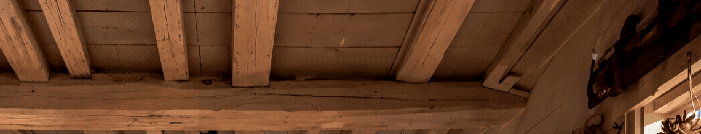

<p align="center">
  
</p>

<h1 align="center">Picline</h1>

<p align="center">
Hang the pictures you need at the top of the screen and take them back whenever you send or edit — consecutive screenshots no longer overwrite each other: hang each as you take it, then drag one or several away together.<br>
A photo line in the macOS menu bar — and you can hang several from a folder at once.<br>
macOS and Windows from the same source · works on every Space · 11 interface languages
</p>

<p align="center">
macOS 14+ · Windows 10 / 11 · free and open source
</p>

<p align="center">
<a href="https://github.com/Xinguangcuican/Picline/releases/latest"><b>↓ Download</b></a> ·
<a href="README.md">中文</a>
</p>

<p align="center">
  
</p>

---

## What this is

Picline is a fork of [Tendedero](https://github.com/alejandrobujan/tendedero) by Alejandro Buján. The Picline branch (by 老张) strengthened how pictures are taken in: it reads third-party screenshot tools off the clipboard, merges duplicates across sources, and lets you choose which app opens a picture. This repository fixed the multi-Space bug, taught the line to stay quiet inside Mission Control, and added AirDrop, press-and-hold Quick Look, a Finder entry, and picking several photos out to use them together.

Two platforms, the same set of gestures:

| | macOS | Windows |
| --- | --- | --- |
| Lives in | Menu bar icon + a line at the top of the screen | Tray icon + a line at the top of the screen |
| Installs as | `Picline-0.3.2.dmg`, dragged into Applications | A single exe, no installer |
| Add to selection | `Command` | `Ctrl` |
| Interface languages | 11, switchable | Chinese |

---

## The two things it is for

### 1. Screenshot one, hang one, drag them all away at the end

The system clipboard only remembers the last picture. Take a second screenshot and the first is gone — so five screenshots in a row means saving each one, or going back to the folder to find them.

Picline hangs every picture on the line at the top of the screen instead. They sit side by side, and a new one does not push out the one before it. When you are done, click the ones you want, and drag the group into WeChat, Slack, Keynote, or any window that takes pictures — drag five across and five land there.

Nothing to save first, and no hopping between the window you are working in and a folder.

### 2. A folder of pictures, hung several at a time

A folder has a batch of pictures and you need three of them for one person, or for laying out in an editor — you should not have to drag them in one at a time.

Select those three in Finder and choose Open With → Picline; on Windows, select them and right-click "挂到 Picline". You can also hold a picture and drag it to the top of the screen, where the line comes down to take it. As many as you select is as many as get hung, and then you drag the group away as above.

What hangs is a copy, so the original can be moved or deleted afterwards and the card stays.

---

## Downloads

Everything is on the [Releases](https://github.com/Xinguangcuican/Picline/releases/latest) page.

| Platform | File | Notes |
| --- | --- | --- |
| macOS | `Picline-0.3.2.dmg` | Universal binary: Apple silicon and Intel in one package |
| macOS | `Picline-0.3.2.zip` | Same, for people who prefer a zip |
| Windows x64 | `Picline-0.2.6-win-x64.exe` | Nearly every 64-bit Windows |
| Windows ARM64 | `Picline-0.2.6-win-arm64.exe` | Snapdragon laptops and other ARM machines |
| Windows | `Picline-0.2.6-win.zip` | Both exes and the readme |

Neither build is code signed. On macOS, allow it once in Privacy & Security. On Windows, SmartScreen asks for "More info → Run anyway".

---

# macOS

## Install

1. Open `Picline-0.3.2.dmg` and drag `Picline` into Applications.
2. The first launch is blocked by Gatekeeper (no notarisation). Either allow it in System Settings → Privacy & Security, or run:
   `xattr -dr com.apple.quarantine /Applications/Picline.app`
3. The menu bar icon appears. Tick "Hang copied images" in the menu to start collecting.

## Bringing the line down

| Gesture | What happens | Since |
| --- | --- | --- |
| Pointer touches the menu bar | The line comes down at once, with a 0.06 s buffer so a pointer merely passing through does not pull it out | 0.1.x; instant as of 0.2.6 |
| Hold a key, then touch the menu bar | Bring the line down → "Only with a key held", choose `⌘` / `⌥` / `⌃` / `⇧`. Without the key nothing happens | **0.2.7** |
| An empty line stays away | With nothing hanging, touching the top does nothing, so reaching for the Wi-Fi menu is not blocked; the shortcut and the menu still open it. A picture being carried in is the exception: the line comes down to take it | 0.2.8 (0.2.5–0.2.7 came down) |
| Hold the button and drag a picture up | Once the pointer is within two menu bars of the top edge (about 64 / 50 points) the line comes down, dipping to meet it; let go and the picture hangs | **0.3.1** |
| The very first run | The line comes down by itself for nine seconds, saying what hangs on it and how to call it back | **0.3.0** |
| Click anywhere in the menu bar | Puts it away | 0.1.x |
| Pointer leaves for 0.5 s | Tucks itself away; an empty line goes on the same frame instead of waiting out the half second | 0.1.x; empty line instant as of **0.3.1** |
| `Control + Option + T` | Show / hide; change it under Shortcut → Change Shortcut | 0.1.9 |

It comes down on whichever screen you touched the top of, drawn at that screen's scale. It stays out of the way over full screen apps unless you ask for it with the shortcut or the menu.

## The photos on the line

| Gesture | What happens | Since |
| --- | --- | --- |
| Click | Picks that photo out, with a ring around it | 0.2.6 |
| `Shift` + click | Picks the run between the last pick and this one | 0.2.6 |
| `Command` + click | Adds or removes one | 0.2.6 |
| Drag a picked photo | The whole group travels: several pictures sent to a chat, several files copied into a folder | 0.2.6 |
| Double click | Opens with the app chosen under "Double click opens with", system default by default | 0.1.9 |
| Hold for 0.45 s, or force click | Quick Look, arrow keys page through the whole line | 0.2.1 |
| Middle button | Markup | 0.1.9 |
| Drag into an app | It gets a copy; the photo stays on the line | 0.1.x |
| Drag into a folder or the Desktop | The file goes there and leaves the line | 0.1.x |
| Drag onto the Trash | Deleted | 0.1.x |
| Click the corner cross | Takes down that one photo | 0.1.x |
| Where the file goes | Screenshots this app made go to the Trash, recoverable; a photo hung from your own folder only leaves the line | 0.1.x; written down as of **0.3.0** |

## The right-click menu

Every item acts on what is picked out: three photos picked and one of them right-clicked means three of everything. Titles carry the count, e.g. "Save to Desktop · 3 photos".

| Item | What it does | Since |
| --- | --- | --- |
| Copy / Open / Quick Look / Markup | Copying lives only here now; a group is written as several files | 0.1.9; group-wide and click-no-longer-copies as of 0.2.6 |
| Show in Finder | Reveals the file, the whole group selected | 0.1.9 |
| Send via AirDrop | The system window lists nearby devices; a group goes in one go | 0.2.1 |
| Save to Desktop | Saves each one: photos from the line's own folder move, anything else is copied | 0.1.9 |
| Discard / Take down / Move to Trash | Off the line, and the file deleted only when it was the app's own copy | 0.1.9 |
| Take down everything to the left / right | Clears one side; greyed out while a group is picked | 0.1.9; greyed as of 0.2.7 |
| Take everything down | Empties the whole line | 0.2.6 |

## Updates

| What happens | Result | Since |
| --- | --- | --- |
| Twenty seconds after launch, then daily | The app asks GitHub itself; a newer build arrives as a system notification that opens the download page | **0.3.0** |
| One notification per version | It never nags again about something you ignored | **0.3.0** |
| The line at the top of the menu | "Picline x.y.z is available" while there is something newer | **0.3.0** |
| "Check for Updates…" | Asks on the spot and answers: download / later / already current / no network | 0.1.x (used to open a web page); real check as of **0.3.0** |

## Taking pictures in

- **Clipboard**: pictures copied by a screenshot tool, from a browser, or image files copied in Finder, with no folder to add. Tick "Hang copied images" to enable.
- **Watched folders**: menu → "Also watch folders" → "Add Folder…". A screenshot tool's save folder or its temporary folder both work; dated subfolders are watched too.
- **System screenshots**: "Handle screenshots" points the macOS screenshot tool at the app's own folder and turns off the floating thumbnail; it is restored when you turn the option off or quit.
- **Duplicates**: matched on decoded pixels and orientation, so the same picture arriving from a folder, the clipboard or two tools hangs once. Cropped, annotated or recompressed counts as different.

## Hanging a picture from Finder

Select one or more pictures, right-click → Open With → Picline. The picture is copied into the app and hangs on the line. Third-party file managers that offer Open With work the same way, and you can drag pictures onto the app icon.

**You can also drag them onto the line** (as of 0.3.1): hold a picture and drag it to the top of the screen. The line comes down to take it and a dashed outline shows where it will land. Several at once work. The press has to be held, the pointer has to actually move, and it has to reach within two menu bars of the top edge — which is why clicking the menu bar or resting a finger up there no longer brings the line down.

## Building from source

```sh
scripts/build-picline.sh release    # universal binary (arm64 + x86_64) in build/Picline.app
scripts/package-dmg.sh              # build/Picline-<version>.dmg
swift test --disable-sandbox        # 104 tests
swift scripts/check-strings.swift   # 83 strings × 11 languages
```

---

# Windows

> Every Windows release adds one to the last number, and carries into the middle one at 9 — `0.1.9` is followed by `0.2.0`, so nothing is ever as wide as `0.1.13`. Counting that way, this release is **0.2.5**; the four two-digit numbers before it (`0.1.10`–`0.1.13`) are `0.2.0`–`0.2.3`.

The Windows half has a repository of its own — [`Xinguangcuican/Picline-Windows`](https://github.com/Xinguangcuican/Picline-Windows) — where its history can be read on its own and where the Windows builds get their own releases. `windows/` here is a mirror of it.

The two version numbers move independently: macOS is on **0.3.2**, Windows on **0.2.6**. 0.3.2 only touched the Mac side (Mission Control, narrower hover zone) and left the Windows line unchanged, so it stays at 0.2.6; the last version that moved both was 0.3.1 / 0.2.6 (dragging pictures in).

## Install

1. Download `Picline-0.2.6-win-x64.exe` (most machines) or `Picline-0.2.6-win-arm64.exe` (ARM laptops).
2. Double-click it. Nothing is installed and no registry keys are written, apart from the optional Explorer right-click entry, which can be switched off and removes its own key.
3. SmartScreen stops the first run (unsigned): More info → Run anyway.

## Bringing the line down

| Gesture | What happens | Since |
| --- | --- | --- |
| Pointer rests at the very top of the screen | The line comes down (0.09 s buffer); with nothing hanging it stays away | 0.1.0; empty line ignored as of 0.2.0 |
| Hold a key, then touch the top | Tray menu → "贴顶唤出" → no key / `Ctrl` / `Alt` / `Shift`; the choice is remembered | 0.1.8 |
| Hold the button and drag a picture up | Within about 56 points of the top edge the line comes down, a dashed outline showing where it will land; let go and it hangs | **0.2.6** |
| Pointer leaves for 0.5 s | Tucks itself away; an empty line goes at once instead of waiting out the half second | 0.1.0; empty line instant as of **0.2.6** |
| `Ctrl + Alt + T` | Show / hide, **changeable**: tray → "快捷键：…", press the new combination (`Esc` cancels, `Delete` clears it) | 0.1.0; changeable as of 0.1.9 |
| `Ctrl + Alt + Shift + Q` | Quit | 0.1.0 |

## The cards on the line

| Gesture | What happens | Since |
| --- | --- | --- |
| Click | Picks the card out, with a blue ring | 0.1.5 |
| `Shift` + click | Picks everything between the two | 0.1.5 |
| `Ctrl` + click | Adds or removes one | 0.1.5 |
| Drag a picked card | The whole group travels; dropping it in a chat window sends them all | 0.1.5 |
| Double click | Full screen preview: desktop dimmed, picture as large as possible, name and pixel size underneath | 0.1.5 |
| Arrow keys in the preview | `←` `→` step through the line, `Home` / `End` jump to the ends, the caption reads "3 / 7 · name · size"; `Esc`, space or a click closes it | 0.2.3 |
| Hover | A small cross appears in the corner; it takes that one card down | 0.1.3 |
| Drag a card out | Into WeChat or QQ to send it, onto the Desktop or a folder to keep a png | 0.1.4 |
| Right-click | See below | 0.1.3 |

## The right-click menu

| Item | What it does | Since |
| --- | --- | --- |
| Preview / Copy picture / Copy as file | Copy picture writes `CF_DIB`, so `Ctrl + V` in WeChat sends it; copy as file writes `CF_HDROP` | 0.1.3 |
| Save to Desktop / Show in Explorer / Open with default viewer | Saves a png, reveals the file, hands it to the default viewer | 0.1.3 |
| **Markup** | Opens the file in Paint; the card follows the save, and a missing Paint is reported instead of doing nothing | 0.2.3 |
| Take down this / everything to the left / to the right / everything | Off the line; both side items grey out while a group is picked | 0.1.3; greyed as of 0.1.7 |
| **Group-wide** | Three cards picked, right-click any one: "Save to Desktop (3)" saves three | 0.1.6 |

"Copy picture" is the exception: a clipboard holds one bitmap, so it copies the card that was right-clicked. Use "Copy as file" or a drag for several.

## Taking pictures in, and the rest

| Feature | Notes | Since |
| --- | --- | --- |
| Clipboard | DIB from screenshot tools, PNG from browsers and tools, image files copied in Explorer | 0.1.1 |
| Explorer right-click "挂到 Picline" | Select pictures, right-click, they hang on the line; no need to start the app first (Windows 11: "Show more options") | 0.1.2 |
| Drag a picture to the top edge | The line comes down to take it, with a dashed outline where it will land; several at once work | **0.2.6** |
| Tray menu | Show / hide, take everything down, reveal key, Explorer entry on/off, quit | 0.1.2 |
| Several screens and scaling | Comes down on the screen you touched, drawn at that screen's scale | 0.1.2 |
| Full screen and single instance | Stays away over full screen apps; double-clicking twice does not make two lines | 0.1.2 |
| **Launch at login** | One tick in the tray menu, one value under `HKCU\\...\\Run`, removed when unticked | 0.2.3 |
| **Check for updates** | Tray → "检查更新…"; asks GitHub in the background and compares the Windows version read from the asset names, not the macOS tag | 0.2.3 |
| **Tray icon** | Its own icon instead of the generic system one; follows light and dark, fades when the line is empty | 0.2.1; one colour as of 0.2.2 |
| **WebP / HEIC / AVIF** | Falls back to the system WIC when GDI+ cannot read it (HEIC needs the HEIF extension installed) | 0.2.3 |

## Building from source

The source is in [`windows/`](windows/): Rust with hand-written Win32 and GDI+ bindings, no runtime to install. Both architectures are cross-compiled from a Mac with llvm-mingw:

```sh
cd windows
scripts/build-win.sh both     # dist/Picline-<version>-win-{x64,arm64}.exe
```

---

## How macOS and Windows differ

The two builds are aligned item by item, but some gestures are native to one platform. This is the whole list, nothing hidden:

| | macOS | Windows |
| --- | --- | --- |
| Double click | Opens the file in the default or chosen app | Full screen preview window |
| Quick Look / Markup | Yes: hold or force click to look, middle button for Markup | Markup yes (right-click → "标记", through Paint, saved back to the file); Quick Look no, the double-click preview stands in |
| AirDrop | Yes | No; copy the picture and paste it, or drag the card out |
| Add to selection | `Command` | `Ctrl` |
| Reveal shortcut | Editable, default `⌃⌥T` (menu bar → Shortcut → Change Shortcut) | Editable, default `Ctrl + Alt + T` (tray → 快捷键：…, press the new combination) |
| Hanging a picture | Finder → Open With → Picline, or drag a picture to the top of the screen | Explorer right-click → 挂到 Picline, or drag one to the top of the screen (as of **0.2.6**) |
| Interface language | 11 languages | Chinese |
| Image formats | Anything ImageIO decodes, webp and heic included | Anything GDI+ or the system WIC decodes (webp and heic depend on the codecs installed) |
| Virtual desktops | Works on every Space | The window does not follow a desktop switch |
| Launch at login | A menu tick | A tick in the tray menu (writes one HKCU Run value) |

---

## Recent versions

The full history is in [`CHANGELOG.md`](CHANGELOG.md) (Chinese).

- **0.3.2 — 2026-11-11 (macOS only, Windows stays 0.2.6)** The line no longer comes down inside Mission Control, App Exposé or Launchpad, where dragging a window to another desktop is the same held-button-crossing-the-top-edge gesture as carrying a picture up, and the drop belongs to the spaces bar rather than to the line. The hover zone also shrinks from the whole menu bar to a 320-point strip in the middle, wider than the notch, which hands the Apple menu, the app menus, Control Centre, the battery, Wi-Fi and the clock back to the system. Dragging a picture in still uses the full width.
- **0.3.1 — 2026-11-06 (macOS)** Pictures can be dragged in: hold one in Finder, drag it to the top of the screen, and the line comes down to take it, with a dashed outline showing where it will land. The catching strip is two menu bars tall, so window drags and text selections no longer summon the line. A press counts as carrying only if it is held and actually moves, and an empty line leaves the moment the pointer does.
- **0.3.0 — 2026-11-05 (macOS) / 0.2.5 (Windows)** Picline finds its own updates: a system notification, a line at the top of the menu, and a check that answers on the spot. The first run introduces itself for nine seconds. Windows stops leaving a temporary PNG behind on every drag, and taking a card down recycles the files the app made for it.
- **0.2.9 — 2026-11-04 (macOS) / 0.2.4 (Windows)** The Windows build catches up: arrow keys page through the preview, the tray icon fades when the line is empty, launch at login, check for updates, "mark up" through Paint with the card following the save, and WebP / HEIC / AVIF loading. macOS code unchanged. The Windows build also moved to single-digit numbering — after `0.1.9` comes `0.2.0` — which puts this release at `0.2.4`.
- **0.2.8 — 2026-11-04** An empty line no longer drops when the pointer reaches the top, so the Wi-Fi menu is no longer covered by a bare rope. With photos hanging nothing changed; the shortcut, the menu and a new screenshot still bring it down. The Windows build also got its own icon, instead of the generic system one; the tray uses a one-colour version that flips with a light or dark taskbar.
- **0.2.7 — 2026-11-02** Bringing the line down can require a key to be held (`⌘` / `⌥` / `⌃` / `⇧`; `Ctrl` / `Alt` / `Shift` on Windows). The Windows shortcut is no longer fixed either: press a new one in the tray.   Both side items grey out while a group is picked. The Windows source now lives in this repository.
- **0.2.6 — 2026-11-02** Pick several photos out: `Shift` to extend, drag the group, right-click a group and the menu acts on all of it with the count in the title. A click no longer copies. The line comes down the instant the pointer touches the menu bar. "Take everything down" joins the card menu.
- **0.2.5 — 2026-11-02** An empty line comes down too, so the app never looks dead.
- **0.2.4 — 2026-11-02** Finder entry moved to Open With, which is reliable, instead of the Services menu.
- **0.2.3 — 2026-11-02** Finder service and intake fixes.
- **0.2.2 — 2026-11-01** Release-pipeline check; identical to 0.2.1.
- **0.2.1 — 2026-11-01** AirDrop and press-and-hold Quick Look.

## How the multi-Space bug was fixed

An `NSPanel` with `canJoinAllSpaces` can get pinned to one Space for good after an `orderOut` / `orderFront` cycle — that is upstream [issue #80](https://github.com/alejandrobujan/tendedero/issues/80). The fix is not to repair that window but to **rebuild it when it turns out not to be on the current desktop**. All of it lives in `Sources/Tendedero/AppDelegate.swift`, 31 lines; everything since is built on it.

## Lineage

```
Tendedero (Alejandro Buján, MIT)
└─ Picline 0.1.9 (老张: clipboard and intake)
   └─ Picline 0.2.0 (fix: multi-Space, upstream issue #80)
      ├─ 0.2.1 (new: AirDrop, press-and-hold Quick Look)
      ├─ 0.2.2 (check: release pipeline, otherwise identical to 0.2.1)
      ├─ 0.2.3 (new: Finder Services entry; intake fixes)
      ├─ 0.2.4 (change: Open With instead of Services)
      ├─ 0.2.5 (new: an empty line comes down too)
      ├─ 0.2.6 (new: click to pick, ⇧ to extend, ⌘ to add; group drag and group menus)
      ├─ 0.2.7 (new: the reveal can require a held key; rebindable shortcut)
      ├─ 0.2.8 (change: an empty line no longer sits at the top edge)
      ├─ 0.2.9 (the Windows build catches up; macOS untouched)
      ├─ 0.3.0 (new: the app asks GitHub for updates; a first-run introduction)
      ├─ 0.3.1 (new: drag a picture to the top edge and it hangs; change: a two-menu-bar catching strip)
      ├─ 0.3.2 (fix: no line inside Mission Control, App Exposé or Launchpad; change: the hover zone is the middle 320 points)
      │
      └─ Picline for Windows: 0.1.0 → 0.2.6 (17th build)
            Rust + Win32, its own repository, the same gestures as macOS; 0.2.6 is the Windows half of 0.3.1
```

Within a tier the versions run downwards in time. The earlier detail lives in [`CHANGELOG.md`](CHANGELOG.md) (Chinese), one section per version, each split into new / changed / fixed.

This repository only adds features and the multi-Space fix. The names and icons are not covered by the MIT licence; see [`NOTICE`](NOTICE).

## Licence

MIT, original copyright Alejandro Buján. The Tendedero and Picline **names and icons are not part of the MIT grant**. This project keeps the Picline name and its own icon and is not an official release or endorsement by upstream or the original author.
